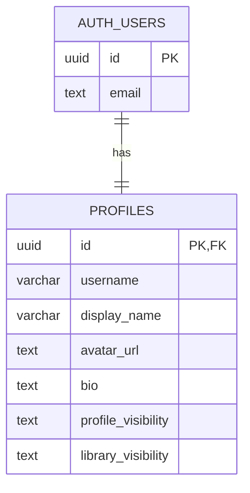

# ShowTracker — Database Architecture & Schema Guide (Phase 1)

Welcome to the ShowTracker database guide. This document explains the database structure, concepts, and security rules in beginner-friendly, plain language for software engineers familiar with SQL but new to PostgreSQL and Supabase.

---

## 1. Core Database Concepts in Plain English

### What is PostgreSQL?
PostgreSQL (often called "Postgres") is an enterprise-grade, open-source object-relational database system. While you use SQL to query it, PostgreSQL provides powerful native features such as:
- **UUID (`UUID`)**: Universally Unique Identifiers (128-bit numbers) instead of predictable sequential integers (like 1, 2, 3), preventing attackers from guessing IDs.
- **Timestamps with Time Zone (`TIMESTAMPTZ`)**: Automatically handles and normalizes timestamps in UTC, avoiding timezone bugs across global users.
- **Row Level Security (RLS)**: Security rules enforced directly by the database engine at query time.
- **Strong Constraints & Triggers**: Guarantees data integrity before any row is saved.

### Project vs Database vs Schema vs Table
Think of the database hierarchy like a filing cabinet in an office:
1. **Supabase Project:** The entire office building hosting your managed PostgreSQL instance, authentication server, and API gateway.
2. **Database:** The filing cabinet inside the office (by default named `postgres`).
3. **Schema:** A labeled drawer inside the filing cabinet. PostgreSQL uses schemas to group tables:
   - `auth`: A private drawer managed by Supabase containing authentication users, passwords, sessions, and OAuth links. We do not edit this directly.
   - `public`: The standard application drawer where our ShowTracker tables (`profiles`, and later `media_items`, `user_library`) live.
4. **Table:** A specific file folder inside a drawer (e.g., `public.profiles`), where each row is an individual record and each column is a specific attribute.

### Why Supabase for ShowTracker?
Supabase provides a hosted, production-grade PostgreSQL database with zero local server installation needed, along with built-in authentication, a browser SQL Editor, and a visual Table Editor.

---

## 2. Phase 1 Entity Relationship Diagram

In Phase 1, ShowTracker establishes the identity and profile foundation:



### Explaining the Relationship in Plain English:
- `AUTH_USERS` (`auth.users`) is maintained automatically by Supabase Auth whenever a user signs in with Google. It stores sensitive authentication data such as email and OAuth tokens.
- `PROFILES` (`public.profiles`) is our application table. It stores ShowTracker-specific user information (username, display name, avatar, bio, and privacy flags).
- Every profile row shares the exact same `id` (UUID) as the authentication record.
- **One-to-One (`||--||`)**: One authentication user has exactly one ShowTracker profile.
- **Cascading Deletion (`ON DELETE CASCADE`)**: If an authentication user account is deleted in Supabase Auth, PostgreSQL automatically removes their profile row.

---

## 3. The `public.profiles` Table Definition

```sql
CREATE TABLE IF NOT EXISTS public.profiles (
    id UUID PRIMARY KEY REFERENCES auth.users(id) ON DELETE CASCADE,
    username VARCHAR(40),
    display_name VARCHAR(80),
    avatar_url TEXT,
    bio VARCHAR(300),
    profile_visibility TEXT NOT NULL DEFAULT 'PUBLIC',
    library_visibility TEXT NOT NULL DEFAULT 'PUBLIC',
    created_at TIMESTAMPTZ NOT NULL DEFAULT NOW(),
    updated_at TIMESTAMPTZ NOT NULL DEFAULT NOW(),

    CONSTRAINT profiles_profile_visibility_check
        CHECK (profile_visibility IN ('PUBLIC', 'PRIVATE')),

    CONSTRAINT profiles_library_visibility_check
        CHECK (library_visibility IN ('PUBLIC', 'PRIVATE')),

    CONSTRAINT profiles_username_format_check
        CHECK (username IS NULL OR (username ~ '^[a-z0-9_]{3,30}$' AND username = LOWER(username)))
);
```

### Column Breakdown

| Column | Type | Description |
|---|---|---|
| `id` | `UUID` | Primary Key and Foreign Key pointing directly to `auth.users(id)`. |
| `username` | `VARCHAR(40)` | Unique handle (e.g., `spike_spiegel`). Nullable initially until user finishes onboarding in Phase 2. |
| `display_name` | `VARCHAR(80)` | Friendly display name shown on profile pages. |
| `avatar_url` | `TEXT` | URL to the user's profile image (e.g., from Google OAuth). |
| `bio` | `VARCHAR(300)` | Short user biography or tagline. |
| `profile_visibility` | `TEXT` | `PUBLIC` or `PRIVATE`. Controls whether visitors can view the profile page. |
| `library_visibility` | `TEXT` | `PUBLIC` or `PRIVATE`. Independent privacy setting for saved anime/shows/movies. |
| `created_at` | `TIMESTAMPTZ` | Timestamp when the profile was created (UTC). |
| `updated_at` | `TIMESTAMPTZ` | Automatically updated whenever any profile field changes. |

---

## 4. Understanding Keys, Constraints & Indexes

### Primary Key (`PRIMARY KEY`)
The unique identifier of each row. In `profiles`, `id` is the primary key. No two profiles can ever have the same ID.

### Foreign Key (`REFERENCES auth.users(id) ON DELETE CASCADE`)
A foreign key links a column in one table to the primary key of another table. It guarantees referential integrity:
- You cannot create a profile for a non-existent user ID.
- `ON DELETE CASCADE` means if a user is deleted from Supabase Auth, PostgreSQL automatically cleans up their profile without leaving orphaned data.

### CHECK Constraints
A `CHECK` constraint tests data before inserting or updating:
- `CHECK (profile_visibility IN ('PUBLIC', 'PRIVATE'))`: Prevents typos or invalid status strings from ever entering the database.
- `CHECK (username IS NULL OR (username ~ '^[a-z0-9_]{3,30}$' AND username = LOWER(username)))`: Enforces lowercase alphanumeric characters and underscores between 3 and 30 characters.

### Case-Insensitive Unique Index
```sql
CREATE UNIQUE INDEX profiles_username_lower_idx
    ON public.profiles (LOWER(username))
    WHERE username IS NOT NULL;
```
- **Why?** If a user registers `alex`, someone else cannot register `Alex` or `ALEX`.
- `WHERE username IS NOT NULL` allows new users to register without a username yet (during Google sign-in) without triggering a duplicate key conflict on `NULL`.

---

## 5. Automatic Profile Creation Trigger

When a user signs in with Google, Supabase Auth inserts a row into `auth.users`. We want ShowTracker to immediately create their matching `public.profiles` row without requiring manual application glue code.

We accomplish this using a PostgreSQL **Trigger**:

```sql
CREATE OR REPLACE FUNCTION public.handle_new_user()
RETURNS TRIGGER
SECURITY DEFINER
SET search_path = public, auth
LANGUAGE plpgsql
AS $$
BEGIN
    INSERT INTO public.profiles (
        id,
        display_name,
        avatar_url,
        username,
        profile_visibility,
        library_visibility
    ) VALUES (
        NEW.id,
        COALESCE(NEW.raw_user_meta_data->>'full_name', NEW.raw_user_meta_data->>'name', NULL),
        COALESCE(NEW.raw_user_meta_data->>'avatar_url', NEW.raw_user_meta_data->>'picture', NULL),
        NULL,
        'PUBLIC',
        'PUBLIC'
    )
    ON CONFLICT (id) DO NOTHING;
    RETURN NEW;
END;
$$;

CREATE TRIGGER on_auth_user_created
    AFTER INSERT ON auth.users
    FOR EACH ROW
    EXECUTE FUNCTION public.handle_new_user();
```

### What is a Database Trigger?
A trigger is a stored function that PostgreSQL executes automatically when a specific event occurs (e.g., `AFTER INSERT ON auth.users`).
- `SECURITY DEFINER`: The function runs with the privileges of its creator (`postgres`), allowing it to write to `public.profiles` even during external auth flows.
- `SET search_path = public, auth`: Explicitly locks down the schema search path to prevent search path spoofing.
- `ON CONFLICT (id) DO NOTHING`: Ensures idempotency—if a profile row already exists, it won't throw an error.

---

## 6. Row Level Security (RLS) & Access Policies

### Authentication vs Authorization vs RLS
- **Authentication**: Proves *who you are* (e.g., verified Supabase Auth token).
- **Authorization**: Express business logic checking permissions before performing an action.
- **Row Level Security (RLS)**: PostgreSQL's built-in defense-in-depth gatekeeper. Even if an application bug queries `SELECT * FROM profiles`, PostgreSQL only returns the rows that the active user's role and ID are allowed to see.

### How `auth.uid()` Works
Supabase provides `auth.uid()`, a SQL function returning the UUID of the currently authenticated request.
- When an authenticated HTTP request arrives at Express, Express verifies the token.
- Inside the database transaction, Express sets the request claim context:
  ```sql
  SELECT set_config('request.jwt.claim.sub', $1, true);
  ```
- Any subsequent query in that transaction evaluates `auth.uid()` as that verified user UUID.

### The Profile Policies

#### 1. SELECT Policy (Reading Profiles)
```sql
CREATE POLICY "Profiles select policy"
    ON public.profiles
    FOR SELECT
    TO public, showtracker_app, authenticated, anon
    USING (
        profile_visibility = 'PUBLIC'
        OR (auth.uid() IS NOT NULL AND auth.uid() = id)
    );
```
- **Rule**: If a profile has `profile_visibility = 'PUBLIC'`, anyone (including guests and search engines) can view it.
- **Rule**: If a profile is `PRIVATE`, *only* the owner (`auth.uid() = id`) can view it.

#### 2. INSERT Policy (Creating Profiles)
```sql
CREATE POLICY "Profiles insert policy"
    ON public.profiles
    FOR INSERT
    TO public, showtracker_app, authenticated
    WITH CHECK (
        auth.uid() IS NOT NULL AND auth.uid() = id
    );
```
- **Rule**: A user can only insert a profile record where the `id` matches their own verified `auth.uid()`. They cannot create profiles under someone else's ID.

#### 3. UPDATE Policy (Modifying Profiles)
```sql
CREATE POLICY "Profiles update policy"
    ON public.profiles
    FOR UPDATE
    TO public, showtracker_app, authenticated
    USING (
        auth.uid() IS NOT NULL AND auth.uid() = id
    )
    WITH CHECK (
        auth.uid() IS NOT NULL AND auth.uid() = id
    );
```
- **Rule**: A user can only modify their own profile. The `WITH CHECK` clause also prevents them from modifying the `id` foreign key.

---

## 7. Restricted Database Role (`showtracker_app`)

### Admin Role vs Application Role
In PostgreSQL, security best practices demand least-privilege access:
1. **Admin / Migration Role (`postgres`)**:
   - Superuser used only in migrations and the Supabase SQL Editor.
   - Can create tables, alter roles, grant permissions, and bypass RLS (`BYPASSRLS`).
2. **Application Role (`showtracker_app`)**:
   - The role used by our Express backend in `DATABASE_URL`.
   - **`NOBYPASSRLS`**: Must strictly obey all Row Level Security policies.
   - **`NOSUPERUSER`**: Cannot alter database settings or create roles.
   - Granted only `SELECT`, `INSERT`, `UPDATE`, `DELETE` on the `public` schema.

---

## 8. How to Inspect & Test in Supabase Dashboard

1. **Table Editor**:
   - Go to your Supabase Dashboard &rarr; **Table Editor** (grid icon in sidebar).
   - Select `profiles` in the `public` schema.
   - You will see the columns, data types, and any records created.
2. **SQL Editor**:
   - Go to **SQL Editor** (terminal icon in sidebar).
   - Click **New Query**.
   - You can run test queries, inspect active roles (`SELECT * FROM pg_roles;`), or run our migration scripts directly.
3. **Database & Migrations**:
   - Navigate to **Database** &rarr; **Roles** to inspect `showtracker_app`.
   - Navigate to **Database** &rarr; **Policies** to visually review the RLS policies on `profiles`.
