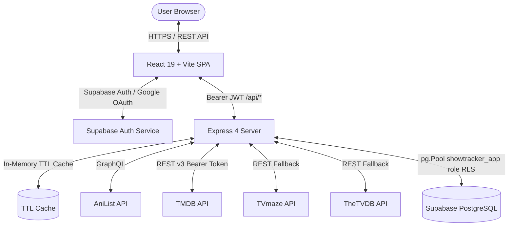

# ShowTracker — Project Architecture & System Map

> **Generated:** Phase 1 Discovery & Architecture Audit  
> **Application:** ShowTracker (Personal entertainment tracker for anime, movies, and TV series)  
> **Repository:** `AniWatch_TRACKER`  
> **Stack:** React 19 (Vite), Node.js 22 (Express ESM), PostgreSQL (Supabase with RLS), Tailwind CSS v3  

---

## 1. System Overview

ShowTracker is a unified media tracker enabling users to discover anime, movies, and television series, organize them in a personal library with custom watch statuses and rating tiers, track episode-by-episode progress across multi-season series and anime franchises, and share a customizable public profile.

The application follows a clean client-server architecture:
- The **frontend (React 19 SPA)** talks exclusively to the **backend (Express 4 API)**.
- The **backend** proxies and normalizes external providers (**AniList GraphQL**, **TMDB REST v3**, **TVmaze REST**, and **TheTVDB**), enforces PostgreSQL **Row Level Security (RLS)** via user-scoped transactions, and maintains a shared media catalog in PostgreSQL.
- Third-party API credentials (such as the TMDB API Read Access Token) remain strictly server-side.



---

## 2. Frontend Architecture

### 2.1 Framework & Core Dependencies
- **Core Framework:** React 19 (`react` 19.3.1, `react-dom` 19.3.1)
- **Bundler & Build Tool:** Vite 8.3 (`vite` 8.3.6), ES Modules, Fast Refresh, Rolldown-based chunking
- **Routing:** React Router v7 (`react-router-dom` 7.18.5)
- **Styling:** Tailwind CSS v3 (`tailwindcss` 3.4.19), PostCSS, Autoprefixer
- **Motion & Animations:** Motion (`motion` 14.14.0)
- **Icons:** Lucide React (`lucide-react` 1.73.0)
- **HTTP Client:** Axios (`axios` 1.21.1) with request interceptors for Supabase auth headers and centralized error normalizer (`toApiError`)
- **Authentication SDK:** `@supabase/supabase-js` 2.119.0 (used strictly for OAuth redirects and token acquisition)

### 2.2 Entry Point & Routing
- **Entry Point:** `client/src/main.jsx` mounts `client/src/App.jsx`.
- **Top-Level Providers:** `BrowserRouter`, `AuthProvider` (`AuthContext.jsx`), and `SignInProvider` (`SignInContext.jsx`).
- **Route Manifest (`client/src/routes/pages.js`):**
  - Declarative code splitting using `React.lazy()` with `pageLoaders`.
  - Prefetching utilities (`prefetchRoute`, `prefetchRouteData`, `prefetchNav`, `prefetchAllRoutesWhenIdle`) that pre-load both code chunks and API resources on hover/focus/idle.
- **Routes (`client/src/App.jsx`):**
  - Focused flows (no shell): `/auth/callback`, `/onboarding` (protected), `/health`.
  - Application frame (`AppShell` with `TopHeader`, `Footer`, `MobileNav`):
    - Public: `/` (`Landing`), `/signin` (`SignIn`), `/explore` (`Explore`), `/trending` (`Trending`), `/media/:provider/:mediaType/:externalId` (`MediaDetails`), `/u/:username` (`PublicProfile`), `/about` (`Credits`).
    - Protected: `/dashboard` (`Dashboard`), `/library` (`Library`), `/settings` (`Settings`).
    - Fallback: `*` (`NotFound`).

### 2.3 Layouts & UI Components
- **`AppShell` (`client/src/components/layout/AppShell.jsx`):** Provides global site header, main content wrapper with responsive padding, fixed mobile bottom dock, and cinematic footer.
- **`TopHeader` (`client/src/components/layout/TopHeader.jsx`):** Desktop navigation bar with active spring pill indicator (`motion`), logo, and user menu or Sign In CTA.
- **`MobileNav` (`client/src/components/layout/MobileNav.jsx`):** Bottom navigation dock for screens below `md` breakpoint with 48px+ touch targets and safe area inset support.
- **Design System:** Custom dark theme palette defined in `tailwind.config.js` (`ink-base`, `ink-surface`, `accent` amber, `fg`, `fg-muted`), custom film grain, 35mm sprocket borders (`client/src/components/cinema/SprocketStrip.jsx`), ghost kanji watermarks (`GhostMark.jsx`), and festival-laurel ratings (`RatingPill.jsx`).

### 2.4 State Management & Caching
- **Auth State:** Managed via `AuthContext.jsx` tracking `user`, `profile`, `session`, `loading`, and `needsOnboarding`.
- **Query & Resource Cache (`client/src/lib/queryCache.js` & `client/src/services/resources.js`):**
  - Lightweight in-memory + `sessionStorage` cache (survives page refresh for user data while keeping heavy catalog items in RAM).
  - Stale-while-revalidate model with configurable `staleMs`.
  - Automatic cache invalidation (`invalidateUserData()`) triggered after mutations (library additions, status updates, episode watch toggles, group additions).
  - Custom hook `useResource` (`client/src/hooks/useApiResource.js`) providing `{ data, loading, error, reload, mutate }`.

### 2.5 Library & Episode Tracking Experience
- **Library Page (`client/src/pages/Library/Library.jsx`):**
  - Displays user's saved titles with filter tabs (`ALL`, `WATCHING`, `COMPLETED`, `PLAN_TO_WATCH`, `ON_HOLD`, `DROPPED`).
  - Media type filters (Anime, TV, Movies), custom shelf/group filter dropdown, sorting (updated at, rating, title), and search filter.
  - Supports quick status changes and deletion with rollback on network failure.
- **Episode Tracking (`client/src/pages/MediaDetails/MediaDetails.jsx` & `client/src/components/media/SeasonAccordion.jsx`):**
  - TV shows: Displays seasons and per-season episodes loaded from `/media/:mediaId/seasons`.
  - Anime: Displays linked seasons (from AniList franchise traversal) or synthetic season episodes.
  - Interactive checkboxes mark individual episodes or entire seasons watched (`/library/:id/episodes/:episodeId/watched` and `/library/:id/seasons/:seasonId/watched`).
  - Auto-updates library status to `WATCHING` on first watched episode, and `COMPLETED` when all episodes are watched.

---

## 3. Backend Architecture

### 3.1 Framework & Core Dependencies
- **Runtime:** Node.js 22 (ES Modules)
- **Framework:** Express 4 (`express` 4.21.2)
- **Database Driver:** `pg` 8.13.1 (`Pool` with SSL mode require)
- **Validation:** Zod (`zod` 4.6.7)
- **Security & Infrastructure Middleware:**
  - `helmet` 8.0.0 (Content Security Policy, frameguard, etc.)
  - `cors` 2.8.5 (configured for client origin)
  - `morgan` 1.10.0 (HTTP logging)
  - Custom IP and user-based in-memory rate limiting (`src/middleware/rateLimit.js`)
  - Custom transaction wrapper enforcing PostgreSQL RLS (`src/db/withUserTransaction.js`)

### 3.2 Entry Point & Routing
- **Server Entry:** `server/src/server.js` initializes database pool, runs startup health checks, and starts HTTP listener on `PORT` (default 5000).
- **App Module (`server/src/app.js`):** Configures middleware pipeline and routes:
  - `/api/health` -> `health.routes.js`
  - `/api/auth` -> `auth.routes.js` (Google OAuth token verification, user profile initialization)
  - `/api/profiles` & `/api/users` -> `profiles.routes.js` (User profile management and public profiles)
  - `/api/media` -> `media.routes.js` (Search, trending, genres, details, seasons, franchise)
  - `/api/library` -> `library.routes.js` (User library entries, stats, continue-watching, recently-updated, upcoming, groups, episode tracking)
- **Global Middleware Pipeline:**
  1. `helmet` with strict security headers
  2. `cors` with allowlist checking
  3. `express.json({ limit: '100kb' })`
  4. Global rate limiter (120 req/min per IP)
  5. Route handlers
  6. Centralized `errorHandler` (`src/middleware/errorHandler.js`)

### 3.3 Database Access & Security Pattern
- **Restricted Database Role (`showtracker_app`):**
  The Express application connects to Supabase PostgreSQL using the restricted `showtracker_app` role (`NOSUPERUSER`, `NOBYPASSRLS`).
- **User Transaction Scoping (`withUserTransaction`):**
  To enforce RLS policies that evaluate `auth.uid() = user_id`, every user-scoped query runs inside a dedicated transaction that executes:
  ```sql
  SET LOCAL "request.jwt.claims" = '{"sub": "<userId>"}';
  ```
  This guarantees that even if application logic were flawed, the PostgreSQL query engine forbids cross-user reading or tampering.
- **Admin / DDL Connection (`migrationPool`):**
  A separate pool connection configured with `MIGRATION_DATABASE_URL` is used strictly for running migrations (`src/db/migrate.js`) and database verification tests.

---

## 4. Data Model & Database Schema

### 4.1 Tables Summary
| Table | Scope | Description |
|---|---|---|
| `public.profiles` | User | User handle, display name, avatar URL, bio, visibility settings (`PUBLIC`/`PRIVATE`). |
| `public.media_items` | Shared Catalog | Normalized media items (title, poster, backdrop, media_type, metadata JSONB). |
| `public.media_sources` | Shared Catalog | External provider mappings (`provider`: ANILIST, TMDB, TVMAZE, TVDB; `external_id`). |
| `public.seasons` | Shared Catalog | Seasons for TV and anime franchises (`season_number`, `name`, `air_date`, `episode_count`). |
| `public.episodes` | Shared Catalog | Episodes (`episode_number`, `title`, `air_date`, `runtime_minutes`). |
| `public.user_library` | User Scoped | User's library rows (`status`, `rating`, `is_favorite`, `notes`, `started_at`, `completed_at`). RLS enforced. |
| `public.user_episode_progress` | User Scoped | Watched episode junction (`user_library_id`, `episode_id`, `watched_at`). RLS enforced. |
| `public.library_groups` | User Scoped | Custom shelves/groups created by users. RLS enforced. |
| `public.library_group_items` | User Scoped | Many-to-many junction between user library entries and library groups. RLS enforced. |

---

## 5. External Provider Integrations

### 5.1 AniList (`server/src/providers/anilist.provider.js`)
- **Protocol:** GraphQL (`https://graphql.anilist.co`)
- **Authentication:** None required (Public queries).
- **Scope:** Anime search, trending ranking, genres, media details, next airing episode metadata, and franchise sequel/prequel graphs.
- **Rate Limit Policy:** 90 requests/minute. Monitored via `x-ratelimit-remaining` and `x-ratelimit-reset` headers with local in-memory throttle.

### 5.2 TMDB (`server/src/providers/tmdb.provider.js`)
- **Protocol:** REST v3 (`https://api.themoviedb.org/3`)
- **Authentication:** Bearer token (`TMDB_API_READ_ACCESS_TOKEN`), backend only.
- **Scope:** Movies & TV shows search, trending daily/weekly, details, seasons, and episodes.
- **Rate Limit Policy:** Standard TMDB limits (40 req/10s); tracked with jittered backoff and circuit breaker.

### 5.3 Fallback Providers (`tvmaze.provider.js` & `tvdb.provider.js`)
- **TVmaze:** Open REST API (`https://api.tvmaze.com`), no API key required. Used as high-reliability primary fallback for TV show schedules, episode lists, and next episode air dates.
- **TheTVDB:** REST v4 fallback with token management.

---

## 6. Architecture Gap Analysis: Upcoming Episodes

### Current Implementation vs Target Requirements

| Aspect | Current Release Radar (`radar.service.js`) | Required Upcoming Episodes Feature | Status / Gap |
|---|---|---|---|
| **Scope of Episodes** | Returns only **1 next episode** per show (`nextAirEpisode` / `nextAiringEpisode`). | Must return **all confirmed episodes** releasing in the upcoming rolling window (e.g. next 3 weekly episodes of a currently running show). | ⚠️ Major Gap |
| **Window Definition** | Mixed; relies on single next date in metadata. | Must enforce rolling 28-day window (`now < episode.airDate <= now + 28 days`) with configurable window constant. | ⚠️ Enhancement Needed |
| **Eligibility Rules** | Filters only `WATCHING` and `PLAN_TO_WATCH` candidates. | Must evaluate all library shows: running shows with confirmed future episodes, announced upcoming seasons with confirmed dates, exclude ended shows without future episodes, exclude TBA dates. | ⚠️ Strict Rules Needed |
| **Navigation & UI** | Embedded compact widget on Dashboard (`ReleaseRadar`). No standalone page or main navigation entry. | Dedicated **Upcoming** page (`/upcoming`), linked in top header navigation and mobile bottom dock, grouped by: Today, Tomorrow, This week, Next week, Later in 28 days. | ⚠️ Page & Nav Needed |
| **Episode Details** | Basic show title, episode number, countdown. | Rich episode cards with episode title, release date, release time (when available), countdown, season/episode badges, poster fallbacks, responsive grid/list. | ⚠️ Full Component Needed |
| **Failure & Cache Handling** | In-memory cooldown per title. | Robust multi-level caching (server-side schedule cache + client query cache), partial failure resilience, loading skeletons, empty state, friendly error retry. | ⚠️ Production Hardening |
