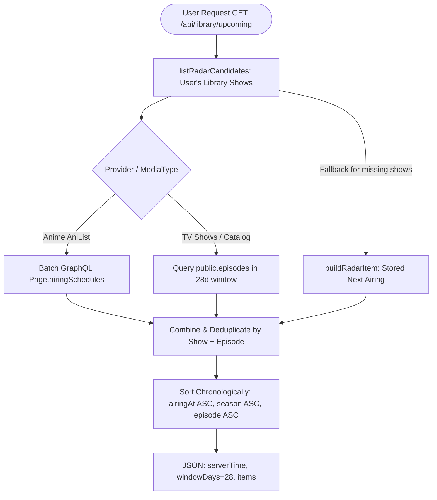

# Upcoming Episodes Implementation Specification & Architecture

## 1. Overview
The Upcoming Episodes feature is a core capability of ShowTracker that allows users to answer the question:
> **"What episodes of my saved shows are releasing in the next few weeks?"**

It displays future scheduled television and anime episodes strictly for shows already saved in the user's personal library across a rolling 28-day release window.

---

## 2. Eligibility & Categorization Rules

An episode is eligible for display if and only if it satisfies **all** of the following criteria:
1. **Saved in Personal Library**: The episode's parent show exists in the authenticated user's library.
2. **Active or Announced Upcoming Status**: The show has an active season currently releasing episodes, an announced upcoming season, or is returning from hiatus.
3. **Confirmed Release Date**: The episode has a verified, non-TBA release date or airing timestamp from the provider (AniList GraphQL or TMDB/local catalog).
4. **Future Airing**: The release date/timestamp is strictly in the future relative to the reference clock (or aired within the last 3 hours for same-day grace period).
5. **Within 28-Day Window**: The release date falls within `now < episode.airDate <= now + 28 days`.
6. **Unique Identification**: Every episode is uniquely keyed by `${entryId}-${episodeNumber}` or `${mediaId}:s${seasonNumber}e${episodeNumber}`.

### Show Categories Handled
| Category | Definition | Qualification Status | Upcoming Badge |
| :--- | :--- | :--- | :--- |
| **Category A: Currently Running** | TV/Anime releasing on a regular weekly schedule with confirmed dates | **Qualified**: All episodes in window included | `Airing` (Emerald) |
| **Category B: Announced Upcoming Season** | Show between seasons or new anime with confirmed premiere in window | **Qualified**: Premiere & subsequent episodes included | `New Season` (Sky) |
| **Category C: On Hiatus** | Show on mid-season hiatus with a confirmed return date in window | **Qualified**: Return episodes included | `Hiatus Return` (Amber) |
| **Category D: Completed or Cancelled** | Show ended with no confirmed future episodes | **Excluded**: Zero items displayed | N/A |
| **Speculative / TBA** | Shows renewed or announced without exact dates | **Excluded**: Speculative dates never displayed | N/A |

---

## 3. Rolling Time Window Policy

- **Window Size**: 28 days (`UPCOMING_WINDOW_DAYS = 28`, `UPCOMING_WINDOW_MS = 28 * 24 * 60 * 60 * 1000`).
- **Configurability**: Controlled by a single constant in `server/src/modules/library/radar.service.js`.
- **Dynamic Forward Motion**: As real-time advances, past episodes drop out and future episodes enter the 28-day horizon automatically.
- **Timezone & Date-Only Preservation**:
  - Exact minute-level timestamps (AniList `airingAt`) are stored as ISO-8601 strings in UTC and rendered in the user's local timezone via `Intl.DateTimeFormat`.
  - Date-only strings (TMDB TV `YYYY-MM-DD`) are parsed by splitting `[year, month, day]` into local calendar midnight, preventing the typical 1-day backward shift experienced by UTC-converting Western timezone users.

---

## 4. Multi-Episode Schedule Retrieval Strategy

Rather than returning only a single next episode per show, the service retrieves the full schedule of episodes releasing in the next 28 days:



### Data Sources
1. **AniList GraphQL `airingSchedules`**:
   - Single batch query retrieving all future episodes within `airingAt_greater: $now, airingAt_lesser: $end` for up to 50 anime concurrently.
2. **PostgreSQL Catalog `public.episodes`**:
   - SQL query joining `public.episodes` and `public.seasons` where `air_date >= CURRENT_DATE AND air_date <= CURRENT_DATE + 28`.
3. **Metadata Fallback**:
   - For shows without multi-episode schedules, gracefully falls back to `metadata.nextAiring` / `metadata.nextAirDate`.

---

## 5. Episode Data Schema

```typescript
interface UpcomingEpisodeItem {
  id: string;                      // e.g. "uuid:s01e07"
  entryId: string;                 // user_library entry UUID
  mediaId: string;                 // media_items UUID
  provider: 'ANILIST' | 'TMDB';
  mediaType: 'ANIME' | 'TV';
  externalId: string;
  title: string;                   // Series title
  posterUrl: string | null;        // Poster image URL
  backdropUrl: string | null;      // Backdrop image URL
  status: LibraryStatus;           // WATCHING | PLAN_TO_WATCH | etc.
  upcomingStatus: string;          // CURRENTLY_AIRING | UPCOMING_SEASON | ON_HIATUS
  seasonNumber: number | null;     // Season number
  episodeNumber: number;           // Episode number
  episodeTitle: string;            // Episode title or fallback
  overview: string | null;         // Episode synopsis
  airDate: string | null;          // YYYY-MM-DD
  releaseDate: string;             // YYYY-MM-DD
  releaseTime: string | null;      // HH:mm:ss or null
  airingAt: string;                // ISO-8601 UTC string
  precision: 'exact' | 'day';      // Minute vs day precision
  timeUntilAiring: number;         // Seconds remaining
}
```

---

## 6. Frontend Architecture & UI Integration

- **Route**: `/upcoming` (Protected via `ProtectedRoute`).
- **Lazy Loading**: Integrated into `client/src/routes/pages.js` with instant hover/focus prefetching (`prefetchNav`).
- **Navigation Points**:
  - **Top Navigation**: Added "Upcoming" nav item to `TopHeader.jsx` for authenticated users.
  - **Mobile Dock**: Added "Upcoming" item with `CalendarClock` icon to `MobileNav.jsx`.
  - **Release Radar Card**: Updated dashboard card with "View all upcoming" direct link.
- **Sections (Non-Empty Only)**:
  - **Today**: Airing today in local timezone with glowing pulse indicator and "REC ● TODAY" tag.
  - **Tomorrow**: Airing tomorrow.
  - **This week**: Airing in 2 to 7 days.
  - **Next week**: Airing in 8 to 14 days.
  - **Later in the next 28 days**: Airing in 15 to 28 days.
- **Filtering**: Type filter pills for **All**, **Anime**, and **TV Shows** with dynamic count badges.
- **States**:
  - **Loading**: `UpcomingSkeleton` displaying animated shimmer placeholders.
  - **Empty**: `EmptyState` explaining that saved shows with confirmed dates will appear here, with an "Explore shows" action button.
  - **Error**: `ProviderErrorState` with retry action.

---

## 7. Automated Test Verification

All requirements verified through `server/test/upcoming-episodes.test.js`:
- `calculateUpcomingStatus properly categorizes timeline into buckets`: **PASSED**
- `Upcoming Window is exactly 28 days`: **PASSED**
- `Category A: Currently airing show with multiple episodes in next 28 days`: **PASSED**
- `Category B: Announced upcoming season with confirmed premiere date in window`: **PASSED**
- `Category C: Hiatus show with confirmed return date`: **PASSED**
- `Category D: Completed or Cancelled show with NO confirmed future episodes is excluded`: **PASSED**
- `Window boundary: Episodes beyond 28 days are excluded`: **PASSED**
- `Library Isolation: User only receives upcoming episodes of shows in their own library`: **PASSED**
